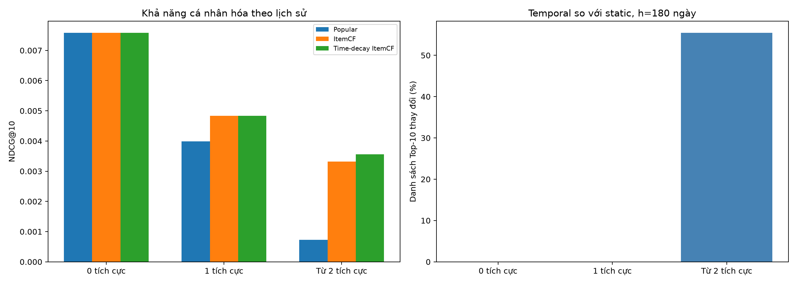

# Hướng 1 — Temporal Recommendation Baseline

**Người thực hiện: Cường Quốc** · **Đã hoàn thành thực nghiệm**  
Lần chạy: 24/10/2026 · Tổng hợp: 25/10/2026.

> **Kết luận chính:** Đã xây dựng mô hình đối chiếu và kiểm chứng tác động trực tiếp của thời gian lên gợi ý. Mô hình có trọng số thời gian làm đổi danh sách 10 sản phẩm đầu ở **55,49% nhóm có từ 2 sản phẩm tích cực**, nhưng mức tăng chất lượng thứ hạng còn nhỏ và chưa có bằng chứng rõ về cải thiện. Mô hình, ứng viên và điểm được chuẩn bị cho Member 2 phát triển Hướng 2.

## 1. Bài toán, dữ liệu và mục tiêu

Mục tiêu chung là giúp cửa hàng tiếp cận khách hàng và tăng cơ hội bán hàng. Phần việc của Hướng 1 là tạo **baseline gợi ý có thể đối chiếu** và kiểm tra việc ưu tiên tương tác gần đây có giúp cải thiện gợi ý khi dữ liệu thưa hay không.

| Dữ liệu All Beauty đã làm sạch | Số lượng |
| --- | ---: |
| Số bản đánh giá sản phẩm | 694.252 |
| Người dùng | 631.986 |
| Sản phẩm có tương tác | 112.565 |
| Người dùng chỉ có một bản đánh giá | 93,19% |

Lịch sử quá ít làm hệ thống khó cá nhân hóa. Thời gian ghi nhận là thời điểm **viết đánh giá**; điểm đánh giá **từ 4 sao trở lên** được quy ước là tương tác tích cực.

## 2. Phương pháp và cách đánh giá

| Mô hình | Nội dung thực hiện |
| --- | --- |
| **Most Popular** | Xếp hạng theo số người dùng đánh giá tích cực của sản phẩm |
| **Item-based Collaborative Filtering + Popular fallback** | Tính độ tương tự cosine từ các cặp người dùng–sản phẩm tích cực; gợi ý bằng tổng độ tương tự. Thiếu ứng viên thì bổ sung sản phẩm phổ biến |
| **Time-decay ItemCF + Popular fallback** | Giữ độ tương tự và cách bổ sung sản phẩm phổ biến; giảm đóng góp của các đánh giá cũ trong lịch sử |

Trọng số thời gian là `w = 2 ** (-age_days / h)`, trong đó `age_days` là tuổi đánh giá tính bằng ngày và `h` là chu kỳ bán rã. Đánh giá gần đây đóng góp nhiều hơn; nếu một cặp người dùng–sản phẩm lặp, lấy thời điểm đánh giá tích cực mới nhất trong lịch sử.

- **Chia dữ liệu theo thời gian:** 70% tập huấn luyện, 20% tập chọn tham số và 10% tập kiểm tra cuối.
- **Chọn tham số:** thử số lân cận là 10, 20, 50, 100 và chu kỳ bán rã là 90, 180, 365 ngày. Chọn **10 lân cận và chu kỳ 180 ngày** theo chất lượng thứ hạng của 10 sản phẩm đầu trên tập chọn tham số.
- **Kiểm tra cuối:** huấn luyện lại bằng tập huấn luyện kết hợp tập chọn tham số rồi cố định lịch sử. Ba mô hình dùng cùng người dùng, danh mục và sản phẩm liên quan để đánh giá. Loại sản phẩm đã đánh giá; sản phẩm mới ngoài danh mục lịch sử vẫn được tính là trường hợp không gợi ý đúng nếu mô hình không đưa ra được.
- **Độ dài danh sách gợi ý:** 10 và 20 sản phẩm. Tập kiểm tra cuối không được dùng để chọn tham số.

## 3. Kết quả và ý nghĩa

**So sánh ba mô hình trên 43.656 người dùng đủ điều kiện trong tập kiểm tra cuối.** Các tham số đã được chốt trước đó bằng tập chọn tham số.

**Danh sách 10 sản phẩm gợi ý:**

| Metric | Most Popular | ItemCF + Popular fallback | Time-decay ItemCF + Popular fallback |
| --- | ---: | ---: | ---: |
| Precision@10 (%) | 0,1636 | 0,1645 | 0,1645 |
| Recall@10 (%) | 1,6218 | 1,6298 | 1,6298 |
| NDCG@10 (0–1) | 0,00732834 | 0,00740466 | 0,00740848 |
| Catalog Coverage@10 (%) | 0,0107 | 5,8720 | 5,8992 |
| CF Slot Fraction (%) | 0,0000 | 2,6986 | 2,6986 |
| Popular-only List Fraction (%) | 100,0000 | 95,9387 | 95,9387 |

**Danh sách 20 sản phẩm gợi ý:**

| Metric | Most Popular | ItemCF + Popular fallback | Time-decay ItemCF + Popular fallback |
| --- | ---: | ---: | ---: |
| Precision@20 (%) | 0,1401 | 0,1405 | 0,1406 |
| Recall@20 (%) | 2,7770 | 2,7850 | 2,7862 |
| NDCG@20 (0–1) | 0,01028960 | 0,01036184 | 0,01036878 |
| Catalog Coverage@20 (%) | 0,0214 | 6,3285 | 6,3537 |
| CF Slot Fraction (%) | 0,0000 | 1,7439 | 1,7439 |
| Popular-only List Fraction (%) | 100,0000 | 95,9387 | 95,9387 |

**Cách đọc các chỉ số:**

- **Precision:** số sản phẩm liên quan trong danh sách chia cho độ dài danh sách gợi ý.
- **Recall:** số sản phẩm liên quan được gợi ý chia cho tổng số sản phẩm liên quan của người dùng trong tập đánh giá.
- **NDCG — Normalized Discounted Cumulative Gain:** đánh giá vị trí của sản phẩm liên quan; sản phẩm phù hợp xuất hiện càng sớm thì điểm càng cao. Điểm nằm trong khoảng 0–1.
- **Catalog Coverage:** tỷ lệ sản phẩm trong danh mục xuất hiện trong ít nhất một danh sách gợi ý.
- **CF Slot Fraction:** cho biết bao nhiêu phần trăm vị trí gợi ý thực sự đến từ mô hình lọc cộng tác.
- **Popular-only List Fraction:** cho biết bao nhiêu phần trăm danh sách không có ứng viên từ lọc cộng tác và được tạo hoàn toàn bằng sản phẩm phổ biến.

Các metric có ký hiệu **(%)** hiển thị theo phần trăm; **NDCG** giữ thang **0–1**.

**Nhận xét từ kết quả:**

- Với Top-10, **NDCG** tăng từ **0,00740466 → 0,00740848**; **Precision** và **Recall** không đổi. Trọng số thời gian có tác động đến thứ hạng, nhưng mức tăng chất lượng còn rất nhỏ.
- **Catalog Coverage** của Top-10 tăng từ **5,8720% → 5,8992%**. **CF Slot Fraction** không đổi; **Popular-only List Fraction** vẫn khoảng **95,94%** ở cả hai biến thể ItemCF.
- Lấy mẫu lặp theo cùng người dùng 1.000 lần (paired bootstrap): chênh lệch NDCG@10 giữa Time-decay ItemCF và ItemCF có **khoảng tin cậy 95% [0,00000000; 0,00001527]**. Khoảng này chứa 0, nên **chưa có bằng chứng rõ về cải thiện NDCG@10**.

**Phân tích theo số sản phẩm tích cực khác nhau trong lịch sử huấn luyện:**

| Lịch sử tích cực | Người dùng | NDCG@10 — ItemCF | NDCG@10 — Time-decay ItemCF | Top-10 thay đổi | Tỷ lệ (%) |
| --- | --- | --- | --- | --- | --- |
| 0 sản phẩm | 41.123 | 0,00758814 | 0,00758814 | 0 | 0,00 |
| 1 sản phẩm | 1.850 | 0,00483546 | 0,00483546 | 0 | 0,00 |
| Từ 2 sản phẩm | 683 | 0,00331668 | 0,00356070 | 379 | 55,49 |

**Biểu đồ so sánh kết quả:**

**Bên trái:** so sánh NDCG@10 giữa ba mô hình theo nhóm lịch sử tích cực. **Bên phải:** tỷ lệ danh sách Top-10 thay đổi khi thêm trọng số thời gian. Các nhóm được tính theo số sản phẩm tích cực khác nhau trong lịch sử huấn luyện.

- **0 sản phẩm tích cực:** dùng sản phẩm phổ biến; **1 sản phẩm:** mọi điểm lọc cộng tác cùng nhân một hệ số dương nên thứ hạng giữ nguyên.
- **Từ 2 sản phẩm:** trọng số thời gian có thể đổi đóng góp tương đối. Thực tế **379/683 người có danh sách 10 sản phẩm thay đổi (55,49%)**, xác nhận yếu tố thời gian đã tác động trực tiếp đến thuật toán.
- Nhóm từ 2 sản phẩm chỉ chiếm **1,56%** người dùng test đủ điều kiện; đây là giới hạn lớn của cá nhân hóa trên bộ dữ liệu này.

Kết quả offline từ review chưa chứng minh tăng doanh thu hoặc lượt mua. Bảng số liệu đầy đủ và biểu đồ là đầu ra của lần chạy thực nghiệm.

## 4. Khoảng trống còn lại và định hướng sang Hướng 2

- **Khoảng trống của Hướng 1:** ItemCF có trọng số thời gian vẫn phụ thuộc lịch sử tương tác, chưa khai thác thuộc tính và quan hệ sản phẩm. Dữ liệu thưa khiến mô hình còn phụ thuộc nhiều vào sản phẩm phổ biến; thay trọng số thời gian chưa bổ sung được tri thức sản phẩm để bù cho thiếu tương tác.
- **Định hướng phát triển — Hướng 2:** Xây dựng **đồ thị tri thức từ metadata**, khai thác thương hiệu, danh mục, thuộc tính và quan hệ sản phẩm để bổ sung thông tin và nguồn ứng viên. Kết hợp với baseline, ứng viên và điểm của Hướng 1 để kiểm chứng hiệu quả trên cùng quy trình đánh giá.

Hướng 1 dùng thời gian ở mức trọng số lịch sử, chưa biểu diễn quan hệ sản phẩm bằng đồ thị tri thức. Đây là giới hạn còn lại của baseline trong dự án và cơ sở phát triển tiếp sang Hướng 2.

## 5. Đầu ra và bàn giao cho Member 2

| Đầu ra | Kết quả |
| --- | --- |
| Quy trình | Đủ 4 notebook; giữ mô hình đối chiếu và bổ sung thí nghiệm thời gian trong notebook 03 |
| Mô hình | ItemCF và Time-decay ItemCF; đã kiểm tra lưu/nạp lại |
| Ứng viên và điểm | Tối đa 100 sản phẩm/người dùng/biến thể; **8.731.200 dòng**, có điểm, thứ hạng và nguồn từ lọc cộng tác hoặc sản phẩm phổ biến |
| Báo cáo | Precision, Recall, NDCG, Catalog Coverage, CF Slot Fraction và Popular-only List Fraction; kèm phân tích nhóm, khoảng tin cậy và biểu đồ |

**Gói đã tạo:** `models/member2_handoff.zip`, gồm hai mô hình, mã Python nạp độc lập, ứng viên/điểm/thứ hạng và cấu hình; kiểm tra nạp lại thành công. Gói cần gửi riêng cho Member 2. Phạm vi ứng viên là nhóm người dùng test đủ điều kiện; Hướng 2 sử dụng thêm dữ liệu và metadata chung.

**Phạm vi của Cường Quốc:** baseline, thí nghiệm thời gian, phân tích dữ liệu thưa và đầu ra bàn giao; không phụ trách chính thuật toán giảm popularity bias.

**Bằng chứng thực nghiệm:** [Bảng test](reports/temporal_cf/test_comparison.csv) · [Chọn tham số trên validation](reports/temporal_cf/validation_grid.csv) · [Phân tích nhóm](reports/temporal_cf/personalization_groups.csv) · [Thay đổi thứ hạng](reports/temporal_cf/rank_change_by_group.csv) · [Khoảng tin cậy](reports/temporal_cf/test_ndcg10_paired_bootstrap.csv) · [Báo cáo tổng hợp](reports/temporal_cf/temporal_summary.md) · [Biểu đồ](reports/temporal_cf/temporal_comparison.png) · [Thông tin bàn giao](reports/temporal_cf/handoff_summary.json).

**Notebook:** [01 — Dữ liệu](01_data_preparation.ipynb) · [02 — ItemCF](02_item_based_cf.ipynb) · [03 — Đánh giá và temporal](03_tuning_and_test.ipynb) · [04 — Biểu đồ và demo](04_results_and_demo.ipynb).

**Tham khảo:** [Recommenders](https://github.com/recommenders-team/recommenders) · [Koren (2009) — Collaborative Filtering with Temporal Dynamics](https://doi.org/10.1145/1557019.1557072).
