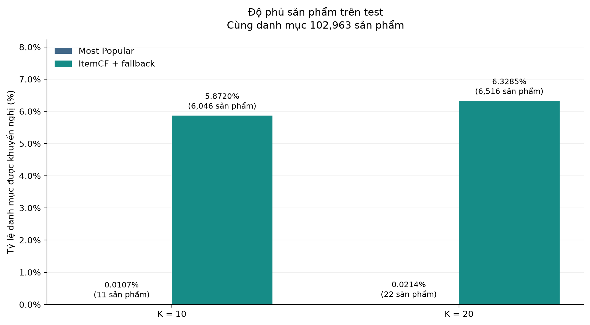
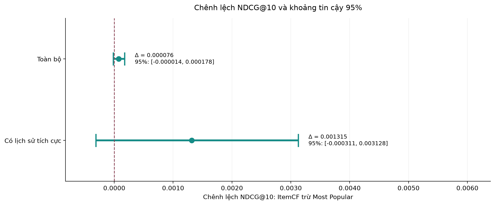

# Hướng 1 — Quá trình thực hiện, nội dung và tổng kết phần baseline khuyến nghị

**Người thực hiện: Cường Quốc**  
**Thời điểm tổng hợp: 21/10/2026**  
**Phần đã triển khai:** chuẩn bị dữ liệu, Most Popular, Item-based Collaborative Filtering, đánh giá và minh họa kết quả.

Phần việc này thuộc đề tài hệ thống khuyến nghị thương mại điện tử kết hợp đồ thị tri thức thời gian và mô hình ngôn ngữ. Bộ notebook hiện tại tạo mốc so sánh thực nghiệm để nhóm đánh giá lợi ích của các phần mở rộng KG/TKG và LLM trong giai đoạn tiếp theo.

## 1. Quá trình thực hiện

### 1.1. Xác định bài toán và mục tiêu

Mục tiêu kinh doanh của đề tài là giúp cửa hàng có thêm cơ hội tiếp cận khách hàng và bán hàng. Với dữ liệu review hiện có, giai đoạn đầu được cụ thể hóa thành bài toán **xếp hạng Top-10/Top-20 sản phẩm có khả năng phù hợp với người dùng**, dựa trên lịch sử đánh giá.

Quá trình triển khai đi từ phương pháp đơn giản Most Popular đến ItemCF, sau đó kiểm tra xem cá nhân hóa có cải thiện chất lượng xếp hạng và mở rộng danh mục được gợi ý hay không. Các chỉ số offline từ review được dùng làm bằng chứng thực nghiệm; hiệu quả về lượt mua và doanh thu cần được kiểm chứng riêng khi có dữ liệu kinh doanh phù hợp.

### 1.2. Khảo sát và kiểm tra lại dữ liệu

Sử dụng file nhóm đã làm sạch và ghép metadata: **`All_Beauty_Cleaned_Merged.xlsx`**, từ Amazon Reviews 2023 — All Beauty. Việc kiểm tra được thực hiện trên toàn bộ file đang dùng cho thí nghiệm.

| Nội dung kiểm tra | Kết quả |
| --- | ---: |
| Số bản ghi review | 694.252 |
| Số người dùng khác nhau | 631.986 |
| Số sản phẩm có tương tác | 112.565 |
| Số sản phẩm trong sheet metadata | 112.590 |
| Người dùng chỉ có một review | 588.942, khoảng 93,19% |
| Giá trị thiếu ở bốn trường lõi | 0 |
| Sự kiện trùng đồng thời user, item và timestamp | 0 |

Bốn trường dùng cho mô hình gồm `user_id`, `parent_asin`, `rating` và `timestamp`. ID được giữ ở dạng chuỗi để bảo toàn số 0 ở đầu; rating được xử lý ở dạng float32 và timestamp ở dạng int64, đơn vị mili giây.

Kết quả khảo sát cho thấy phần lớn người dùng có rất ít lịch sử, làm cho ma trận user–item rất thưa. Đây là hạn chế quan trọng của dữ liệu đối với CF và là lý do cần phân tích riêng nhóm đã có lịch sử tích cực.

Ý nghĩa các cột tên cũng được kiểm tra: `Merged_Data.title` là tiêu đề review, `Merged_Data.product_title` là tên sản phẩm đã ghép; trong sheet `Product_Metadata`, cột `title` là tên sản phẩm. Timestamp được hiểu là thời điểm review, không tự suy diễn thành thời điểm mua hàng.

### 1.3. Chuẩn bị môi trường và dữ liệu xử lý

Triển khai trên VS Code, Python 3.12 và Jupyter với môi trường `.venv`, hướng tới chạy CPU trên máy RAM 16 GB. Bốn trường lõi được tách ra và lưu dưới dạng Parquet để các lần thực nghiệm sau không phải đọc lại toàn bộ Excel.

Quy ước thực nghiệm được thống nhất như sau:

- Review có `rating >= 4` được coi là tương tác tích cực.
- Mỗi cặp user–item tích cực được tính một lần khi tạo ma trận học và đếm số người đánh giá tích cực.
- Các sự kiện lặp cùng cặp nhưng khác thời điểm được giữ trước khi chia dữ liệu; không xóa toàn bộ các cặp lặp trên cả dữ liệu rồi mới chia.
- Khi gợi ý, loại sản phẩm người dùng đã đánh giá ở bất kỳ mức sao nào trong lịch sử huấn luyện.

### 1.4. Chia tập theo thời gian

Dữ liệu được chia theo trình tự thời gian toàn cục, với tỷ lệ xấp xỉ 70%/20%/10%. Hai mốc chia được xác định từ quantile 0,70 và 0,90 với `interpolation='nearest'`; các sự kiện có cùng timestamp được giữ cùng một phía của mốc chia.

| Tập | Số review | Điều kiện timestamp, mili giây |
| --- | ---: | --- |
| Train | 485.977 | `timestamp <= 1607221537757` |
| Validation | 138.850 | `1607221537757 < timestamp <= 1643201980125` |
| Test | 69.425 | `timestamp > 1643201980125` |

Mốc cuối train là `2020-12-06T02:25:37.757Z`; mốc cuối validation là `2022-01-26T12:59:40.125Z`. Cấu hình được lưu để các mô hình trong nhóm có thể dùng chung cách chia.

### 1.5. Xây dựng baseline và mô hình CF

Trước hết xây dựng **Most Popular**: đếm số người đánh giá tích cực cho mỗi sản phẩm trong lịch sử và xếp hạng giảm dần. Đây là mốc so sánh cho phương pháp cá nhân hóa.

Tiếp theo xây dựng **Item-based Collaborative Filtering**. Ma trận user–item có giá trị 1 ở các cặp tích cực; mỗi sản phẩm được biểu diễn bằng vector người dùng đã đánh giá tích cực. Cosine được tính theo khối ma trận thưa, bỏ liên kết với chính sản phẩm và giữ tối đa N lân cận cosine dương. Cách triển khai này tránh tạo ma trận đặc giữa toàn bộ các cặp sản phẩm.

Điểm một ứng viên bằng tổng độ tương tự của ứng viên với các sản phẩm tích cực trong lịch sử người dùng. Khi không đủ ứng viên CF, danh sách được bổ sung bằng Most Popular. Vì vậy tên phương pháp trong kết quả được ghi là **ItemCF + Popular fallback**.

### 1.6. Chọn tham số, đánh giá và trình bày kết quả

Thử N = 10, 20, 50, 100 trên validation; chọn theo NDCG@10 của toàn bộ người dùng đủ điều kiện đánh giá. Nếu bằng nhau, ưu tiên Recall@10 cao hơn rồi N nhỏ hơn. **Cấu hình chọn là N = 10**, được lưu trước khi đọc test. N là số lân cận giữ lại cho mỗi sản phẩm; K = 10/20 là độ dài danh sách trả về.

Mô hình được huấn luyện lại bằng train + validation, sau đó đánh giá test với lịch sử cố định ở cuối validation. Cả độ tương tự, độ phổ biến, danh mục ứng viên và tập sản phẩm đã đánh giá đều được cập nhật từ lịch sử huấn luyện mới này.

Cuối cùng lưu mô hình, kiểm tra nạp lại và đối chiếu danh sách Top-K; tạo 5 biểu đồ cùng ví dụ có tên sản phẩm. Tên được lấy từ `Product_Metadata` và ghép sau khi xếp hạng, nên không tác động vào điểm CF hoặc chọn tham số.

## 2. Nội dung đã thực hiện và đầu ra

### 2.1. Các notebook triển khai

| Notebook | Nội dung đã làm | Đầu ra chính |
| --- | --- | --- |
| [01_data_preparation.ipynb](01_data_preparation.ipynb) | Đọc dữ liệu, kiểm tra trường lõi, chuẩn hóa kiểu dữ liệu, chia tập theo thời gian và tạo mốc Most Popular | Các tệp trong `data/processed/`, gồm train/validation/test và `split_config.json` |
| [02_item_based_cf.ipynb](02_item_based_cf.ipynb) | Xây ma trận thưa, tính cosine, tạo Top-K và so sánh CF ban đầu với Most Popular trên validation | Kết quả ở `reports/item_cf/`, mô hình ở `models/item_cf/` |
| [03_tuning_and_test.ipynb](03_tuning_and_test.ipynb) | Thử N trên validation, chốt cấu hình, huấn luyện lại, đánh giá test và paired bootstrap | `reports/final_cf/` và `models/item_cf_final/` |
| [04_results_and_demo.ipynb](04_results_and_demo.ipynb) | Vẽ biểu đồ, nạp mô hình để dự đoán, ghép tên sản phẩm, xuất ví dụ và bằng chứng CF | `reports/cf_presentation/` |

### 2.2. Quy trình đánh giá chung

Hai mô hình được đánh giá trên cùng danh mục sản phẩm xuất hiện trong lịch sử và cùng người dùng đủ điều kiện. Ground truth gồm các sản phẩm được đánh giá tích cực mới trong tập đánh giá, sau khi loại cặp user–item đã xuất hiện ở bất kỳ mức sao nào trong lịch sử.

Sản phẩm chưa có trong lịch sử vẫn được giữ ở ground truth và tính là miss nếu không gợi ý được. Người dùng không có hit vẫn nằm trong mẫu số khi lấy trung bình. Điều này giúp kết quả phản ánh cả các trường hợp khó của dữ liệu.

| Chỉ số | Cách tính hoặc ý nghĩa |
| --- | --- |
| Precision@K | Số sản phẩm liên quan trong Top-K chia cho K |
| Recall@K | Số sản phẩm liên quan trong Top-K chia cho số sản phẩm liên quan của người dùng |
| NDCG@K | Đánh giá thứ hạng với relevance nhị phân, chiết khấu vị trí và chuẩn hóa theo danh sách lý tưởng |
| CatalogCoverage@K | Số sản phẩm khác nhau có trong các danh sách chia cho danh mục lịch sử |
| `CF_slot_fraction` | Tỷ lệ vị trí trong danh sách do CF trực tiếp cung cấp |
| `popular_only_list_fraction` | Tỷ lệ danh sách hoàn toàn lấy từ Most Popular |

Các chỉ số được tính trung bình theo người dùng và báo cáo cho hai nhóm: toàn bộ người dùng có ít nhất một sản phẩm tích cực mới, và tập con đã có ít nhất một tương tác tích cực trong lịch sử huấn luyện.

Độ bất định của chênh lệch NDCG@10 được phân tích bằng paired bootstrap theo người dùng: ghép kết quả hai mô hình theo cùng user, lấy mẫu lại 1.000 lần với seed 42 và báo cáo khoảng percentile 95%.

### 2.3. Lưu mô hình và minh họa gợi ý

Mô hình cuối lưu ma trận tương tác, ma trận lân cận, ánh xạ ID, bảng độ phổ biến, lịch sử đã đánh giá và cấu hình. Các kiểm tra gồm loại self-loop, giới hạn số lân cận, loại sản phẩm đã đánh giá, không lặp ứng viên và đối chiếu dự đoán trước/sau khi nạp lại.

Ví dụ Top-K hiển thị mã sản phẩm, tên, nguồn CF/Most Popular và điểm CF. Với ứng viên CF, bảng chỉ ra sản phẩm lịch sử có đóng góp cosine lớn nhất; điểm vẫn là tổng tất cả đóng góp. Đây là bằng chứng truy lại từ phép tính mô hình, chưa phải lời giải thích bằng LLM. Điểm CF không được diễn giải thành xác suất mua hàng.

### 2.4. Tệp để leader đối chiếu

| Nội dung | Tệp |
| --- | --- |
| Cấu hình chọn trên validation | [selected_config.json](reports/final_cf/selected_config.json) |
| Toàn bộ các cấu hình đã thử | [validation_grid.csv](reports/final_cf/validation_grid.csv) |
| So sánh cuối trên test | [test_comparison.csv](reports/final_cf/test_comparison.csv) |
| Chênh lệch NDCG@10 và khoảng tin cậy | [test_ndcg10_paired_bootstrap.csv](reports/final_cf/test_ndcg10_paired_bootstrap.csv) |
| Diễn giải kèm các biểu đồ | [presentation_notes.md](reports/cf_presentation/presentation_notes.md) |
| Gợi ý kèm tên và bằng chứng | [demo_cf_top_k.csv](reports/cf_presentation/demo_cf_top_k.csv) |

Các tệp kết quả và hình cần được commit cùng README sau khi chạy notebook 03/04 để các liên kết trên GitHub mở được.

## 3. Tổng kết hướng nghiên cứu

### 3.1. Kết quả thực nghiệm

Các số dưới đây là kết quả tham chiếu của lần chạy kiểm chứng trên file đã làm sạch. Khi bàn giao, đối chiếu với `test_comparison.csv` được xuất trên máy đang dùng. CSV gốc lưu thang 0–1; các cột có ký hiệu % trong bảng này đã nhân 100.

**Toàn bộ người dùng test đủ điều kiện: 43.656 người.** Lịch sử huấn luyện cuối gồm 624.827 review và 102.963 sản phẩm.

| Mô hình | K | Precision (%) | Recall (%) | NDCG | Catalog coverage (%) |
| --- | ---: | ---: | ---: | ---: | ---: |
| Most Popular | 10 | 0,1636 | 1,6218 | 0,00732834 | 0,0107 |
| ItemCF + fallback | 10 | 0,1645 | 1,6298 | 0,00740466 | 5,8720 |
| Most Popular | 20 | 0,1401 | 2,7770 | 0,01028960 | 0,0214 |
| ItemCF + fallback | 20 | 0,1405 | 2,7850 | 0,01036184 | 6,3285 |

**Nhóm có lịch sử tích cực: 2.533 người dùng.** Đây là tập con của nhóm toàn bộ, không phải một mẫu độc lập thứ hai.

| Mô hình | K | Precision (%) | Recall (%) | NDCG |
| --- | ---: | ---: | ---: | ---: |
| Most Popular | 10 | 0,0790 | 0,7698 | 0,00311049 |
| ItemCF + fallback | 10 | 0,0947 | 0,9080 | 0,00442593 |
| Most Popular | 20 | 0,0770 | 1,5002 | 0,00499570 |
| ItemCF + fallback | 20 | 0,0849 | 1,6384 | 0,00624065 |

### 3.2. Nhận xét từ kết quả

**Độ phủ sản phẩm tăng rõ trong lần chạy này.** Ở Top-10, Most Popular đưa 11 sản phẩm khác nhau vào các danh sách, còn ItemCF + fallback đưa 6.046 sản phẩm, trên cùng danh mục 102.963 sản phẩm. Đây là bằng chứng về việc mở rộng danh mục được khuyến nghị, phù hợp với mục tiêu tăng khả năng khám phá sản phẩm.

**Mức cải thiện NDCG@10 còn chưa rõ.** Chênh lệch trung bình của CF trừ Most Popular trên toàn bộ người dùng là **0,00007632**, với khoảng tin cậy 95% **[-0,00001416; 0,00017774]**. Khoảng này chứa 0 nên chưa có bằng chứng rõ về cải thiện NDCG@10 trong phép đánh giá hiện tại. Khoảng tin cậy của nhóm có lịch sử tích cực cũng chứa 0.

**Phương pháp còn phụ thuộc nhiều vào fallback.** Ở Top-10, khoảng **95,94%** danh sách của CF hoàn toàn lấy từ Most Popular; các ứng viên CF trực tiếp chỉ chiếm khoảng **2,70%** tổng số vị trí trong nhóm toàn bộ. Kết quả vì vậy cần được báo cáo đúng với tên ItemCF + Popular fallback.





### 3.3. Những nội dung đã đạt được

- Hoàn thành quy trình từ kiểm tra dữ liệu đến tạo Top-K, đánh giá, lưu mô hình và trình bày kết quả.
- Xác định được baseline và một phương pháp CF có thể chạy lại theo cùng quy tắc.
- Có bộ mốc thời gian, định nghĩa relevance, danh mục ứng viên và nhóm đánh giá để các phần KG/TKG/LLM dùng làm chuẩn so sánh.
- Chỉ ra hạn chế thực tế của dữ liệu ít lịch sử và sản phẩm mới bằng số liệu, thay vì chỉ kỳ vọng mô hình phức tạp hơn sẽ tốt hơn.
- Có bảng kết quả, 5 biểu đồ, danh sách gợi ý kèm tên và bằng chứng CF để leader kiểm tra hoặc dùng khi báo cáo.

### 3.4. Hạn chế và các phần cần phát triển tiếp

| Vấn đề hiện tại | Ý nghĩa và hướng tiếp theo |
| --- | --- |
| Phần lớn người dùng có ít lịch sử | Nghiên cứu cách bổ sung thông tin sản phẩm và quan hệ đã xác minh để hỗ trợ các trường hợp CF khó cá nhân hóa |
| Khoảng 35,71% cặp tích cực mới trong test có sản phẩm chưa có trong lịch sử | CF hiện tại không đưa được các sản phẩm đó vào danh sách; đây là trường hợp cần xem xét phương pháp có thông tin nội dung/KG |
| Dữ liệu thuộc tính chưa đầy đủ, `categories` trong metadata đang rỗng | Kiểm tra thuộc tính thực có, chuẩn hóa thực thể và quan hệ trước khi dựng đồ thị; không tự đồng nhất `store` với thương hiệu hoặc ID cửa hàng |
| Hiện dùng chia tập theo thời gian và mô hình cố định trong test | Mô hình khai thác độ mới tương tác hoặc TKG cần được xây dựng và đánh giá riêng; chia theo thời gian chưa đồng nghĩa với TKG |
| LLM chưa tham gia quy trình CF hiện tại | Chốt một nhiệm vụ cụ thể như trích xuất thuộc tính có kiểm chứng hoặc tạo giải thích từ bằng chứng; đánh giá chất lượng và chi phí riêng |
| Độ phủ sản phẩm chưa đo công bằng theo cửa hàng | Cần định danh cửa hàng và định nghĩa phân bổ hiển thị phù hợp để đánh giá mục tiêu này |
| Dữ liệu là review | Cần log hiển thị, click, mua và thực nghiệm phù hợp để kết luận về hiệu quả kinh doanh |

Khoảng tin cậy bootstrap hiện tại chỉ phản ánh lấy mẫu người dùng của test đang có; chưa bao gồm bất định khi huấn luyện lại hoặc thay đổi thời gian.

### 3.5. Tổng kết

Giai đoạn hiện tại đã xây dựng được bộ baseline khuyến nghị sản phẩm có thể chạy lại, gồm Most Popular và ItemCF với fallback, kèm quy trình đánh giá theo thời gian và các đầu ra để kiểm tra. Kết quả cho thấy ItemCF mở rộng đáng kể danh mục sản phẩm xuất hiện trong các danh sách, nhưng chưa có bằng chứng rõ về cải thiện NDCG@10 so với Most Popular. Đóng góp chính của phần việc là chuẩn hóa dữ liệu và quy trình thực nghiệm, tạo mốc so sánh có số liệu, đồng thời xác định rõ các trường hợp người dùng ít lịch sử và sản phẩm mới cần nghiên cứu tiếp. Các bước tích hợp KG/TKG và LLM cần được đánh giá dựa trên mốc này trước khi đưa ra kết luận về lợi ích cho toàn hệ thống.

## Phụ lục A — Cách chạy lại

Môi trường sử dụng: Python 3.12, VS Code với Python/Jupyter, CPU và RAM 16 GB. Phép tính dùng ma trận thưa và không cần API key.

Mở PowerShell tại thư mục dự án, tạo môi trường nếu chưa có:

```powershell
py -3.12 -m venv .venv
.\.venv\Scripts\python.exe -m pip install --upgrade pip
.\.venv\Scripts\python.exe -m pip install -r requirements.txt
```

Trong VS Code, mở notebook, chọn **Select Kernel → Python Environments → `.venv`**, rồi chạy theo thứ tự:

| Thứ tự | Notebook | Đầu ra chính |
| --- | --- | --- |
| 1 | [01_data_preparation.ipynb](01_data_preparation.ipynb) | Dữ liệu xử lý, train/validation/test và `split_config.json` |
| 2 | [02_item_based_cf.ipynb](02_item_based_cf.ipynb) | Most Popular và ItemCF ban đầu trên validation |
| 3 | [03_tuning_and_test.ipynb](03_tuning_and_test.ipynb) | Chọn N, huấn luyện lại, đánh giá test, mô hình cuối |
| 4 | [04_results_and_demo.ipynb](04_results_and_demo.ipynb) | Biểu đồ, ví dụ có tên sản phẩm và nội dung trình bày |

Đặt các notebook ở thư mục gốc dự án và kiểm tra `Path.cwd()` được in ở ô đầu trỏ tới thư mục này. Chọn **Run All** cho từng notebook. Notebook 03 và 04 có thể chạy sau khi khởi động lại kernel nếu các tệp đầu vào từ bước trước đã tồn tại.

Để ghi lại chính xác các phiên bản thư viện trên máy đã chạy thành công:

```powershell
.\.venv\Scripts\python.exe -m pip freeze > requirements-lock.txt
```

## Phụ lục B — Tổ chức tệp và đưa lên GitHub

| Đường dẫn | Nội dung | Đưa vào Git |
| --- | --- | --- |
| `01_*.ipynb` đến `04_*.ipynb` | Mã nguồn notebook | Có |
| `README.md`, `requirements.txt`, `.gitignore` | Hướng dẫn và cấu hình | Có |
| `reports/final_cf/` | Bảng chỉ số, lựa chọn tham số, chẩn đoán và báo cáo | Có, trừ bảng từng người dùng |
| `reports/cf_presentation/` | Hình PNG, bảng kết quả, ví dụ và nội dung trình bày | Có |
| `data/` và file Excel | Dữ liệu nguồn và dữ liệu xử lý | Chia sẻ riêng |
| `models/` | Ma trận, ánh xạ, lịch sử và mô hình đã lưu | Tạo lại bằng notebook 03 hoặc chia sẻ riêng |
| `.venv/` | Môi trường cục bộ | Cài lại từ requirements |

`.gitignore` đi kèm loại dữ liệu, mô hình, môi trường và các bảng chỉ số theo từng người dùng. Các tệp CSV tổng hợp, ảnh và Markdown trong `reports/` vẫn có thể commit.


Xem thêm [GITHUB_UPLOAD.md](GITHUB_UPLOAD.md) để chọn quy trình đẩy lên repository mới hoặc nhánh riêng trong repository nhóm.

## Tài liệu tham khảo

- [Recommenders — repository tham khảo](https://github.com/recommenders-team/recommenders)
- [scikit-learn — Cross-validation](https://scikit-learn.org/stable/modules/cross_validation.html)
- [SciPy — lưu ma trận thưa](https://docs.scipy.org/doc/scipy/reference/generated/scipy.sparse.save_npz.html)

Repository Recommenders ở trên được dùng làm tài liệu tham khảo; mã và kết quả của nhóm được bàn giao trong repository do nhóm quản lý.
