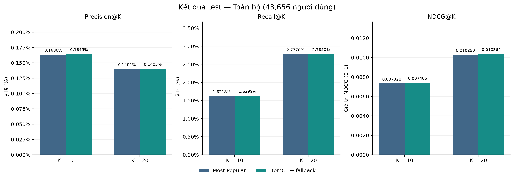
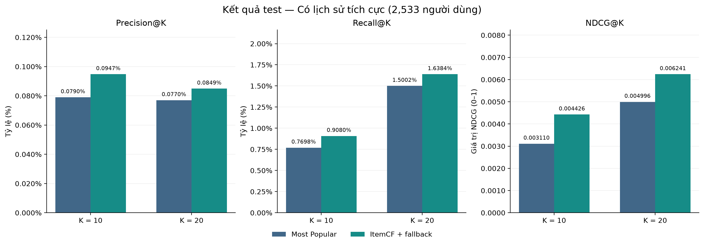
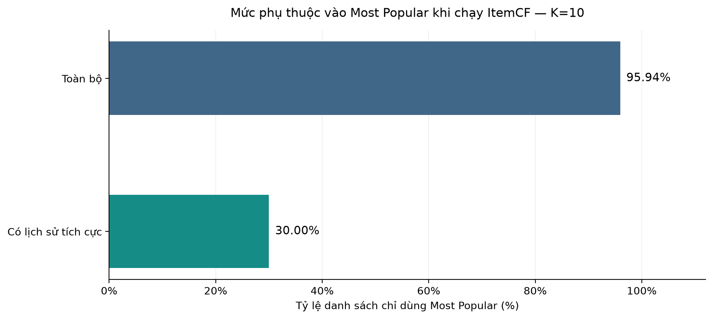

# Kết quả hướng 1 — Gợi ý trình bày

Người thực hiện: Cường Quốc.

## 1. Mục tiêu và đầu ra

Xây dựng mô hình lọc cộng tác tạo Top-10/Top-20 sản phẩm chưa được người dùng đánh giá trong lịch sử, so sánh với Most Popular và tạo chuẩn so sánh cho các hướng KG/LLM. Mục tiêu kinh doanh của toàn đề tài là giúp cửa hàng tiếp cận khách hàng; phần này đo các chỉ số offline ở cấp sản phẩm.

## 2. Thiết kế thực nghiệm

- Chia dữ liệu theo thời gian toàn cục bằng mốc đã lưu ở notebook 01.
- Relevance là review từ 4 sao; mỗi cặp tích cực được dùng một lần khi huấn luyện.
- Chọn N=10 trên validation theo NDCG@10, rồi huấn luyện lại bằng train + validation.
- Cả hai mô hình dùng cùng danh mục 102,963 sản phẩm và cùng nhóm 43,656 người dùng test đủ điều kiện.
- Loại sản phẩm đã đánh giá ở mọi mức sao; giữ sản phẩm chưa thấy trong lịch sử ở ground truth. Lịch sử được cố định trong giai đoạn test.

## 3. Kết quả chính ở K=10, toàn bộ người dùng

| Chỉ số | Most Popular | ItemCF + fallback |
| --- | --- | --- |
| Precision@10 | 0.1636% | 0.1645% |
| Recall@10 | 1.6218% | 1.6298% |
| NDCG@10 | 0.00732834 | 0.00740466 |
| Độ phủ danh mục | 0.0107% (11 SP) | 5.8720% (6,046 SP) |

Khoảng tin cậy 95% chứa 0, vì vậy chưa có bằng chứng rõ về cải thiện NDCG@10 trong phép đánh giá hiện tại. Trung bình chênh lệch NDCG@10 là 0.00007632; khoảng 95% [-0.00001416, 0.00017774].

## 4. Diễn giải giới hạn và ví dụ

- Ở K=10, 95.94% danh sách CF hoàn toàn dùng Most Popular. CF chỉ cung cấp 2.70% tổng số vị trí trong nhóm toàn bộ.
- 35.71% cặp tích cực mới trong test có sản phẩm chưa có trong lịch sử. Mô hình CF hiện tại không đưa được những sản phẩm đó vào danh sách.
- Khoảng tin cậy bootstrap mô tả lấy mẫu người dùng test hiện tại, không gồm bất định khi huấn luyện lại hoặc thay đổi thời gian.
- Độ phủ sản phẩm tăng chưa chứng minh công bằng theo cửa hàng, tăng lượt mua hoặc tăng doanh thu. Để kiểm chứng mục tiêu kinh doanh cần ID cửa hàng và dữ liệu hiển thị/click/mua cùng thí nghiệm phù hợp.
- Ví dụ Top-K minh họa cách mô hình xếp hạng; không dùng một ví dụ để thay thế kết quả trên toàn bộ test.
- Bằng chứng CF là sản phẩm lịch sử có đóng góp cosine dương. Điểm CF không phải xác suất mua; tên metadata chỉ dùng để trình bày sau khi dự đoán.

## 5. Tệp dùng khi báo cáo

- `test_table_for_report.csv`: hai mô hình, hai mức K, hai nhóm; tên cột ghi rõ đơn vị.
- `demo_cf_top_k.csv`: sản phẩm, tên, nguồn, điểm CF và bằng chứng.
- `demo_popular_top_k.csv`: Most Popular cho cùng người dùng.
- `demo_positive_history.csv`: các sản phẩm tích cực đã dùng cho ví dụ.

### Độ chính xác — toàn bộ người dùng

### Độ chính xác — người có lịch sử tích cực

### Độ phủ sản phẩm trên cùng danh mục

### Mức phụ thuộc vào Most Popular

### Chênh lệch NDCG@10 và khoảng tin cậy

